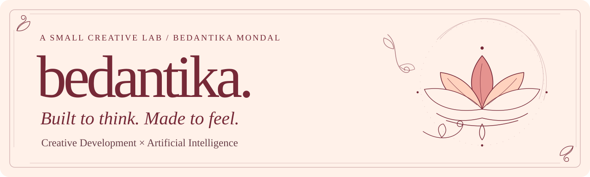

<picture>
  <source media="(max-width: 640px)" srcset="public/readme/portfolio-banner-mobile.svg">
  
</picture>

# Bedantika Mondal · a little creative lab

Hello, I'm Bedantika. I build things that think, move, and occasionally surprise me. This is my personal portfolio: a place to explore AI/ML, expressive frontend development, and the details that make an interface feel like someone cared.

**[Visit the portfolio ↗](https://bedantikamondal-portfolio.vercel.app/)**

*A small field note: the flowers are drawn in SVG. The curiosity is ongoing.*

## About this little corner of the internet

I wanted a space for both sides of my work: the engineering behind intelligent systems and the visual storytelling around them. So editorial type meets handcrafted interactions, a lotus opens the door, and Bengali alpona-inspired curls find their way into the margins.

The website pairs **Instrument Serif** with **Newsreader**, with **Noto Serif Bengali** available for Bengali text. Warm cream, Wine Plum, Peach Fuzz, and Light Coral carry the palette from **Bloom** into **After Dark**.

## A few things to discover

- **An opening bloom.** A custom animated lotus loader hands off to the GSAP hero reveal. Once the name has appeared, Bedantika and Mondal scramble and settle; hovering either word plays its own scramble again.
- **Two moods, one little world.** Bloom and After Dark share a lotus theme switch, alongside a staggered navigation menu.
- **A gallery with a curve.** Five artwork-led projects sit on a 3D circular carousel. Drag, use the arrows, or navigate with the keyboard; hover previews update a separate details panel. The selected artwork stays sharp while its neighbors soften.
- **A tiny friend.** Pengu has a playful place in the playground, with a click reaction and links to the virtual-pet project.
- **A growing story.** The botanical Lotus Journey accompanies my education, with scroll-linked motion and section reveals.
- **Four cards, four compositions.** The Tech Stack flips in 3D with tilt and a subtle glare. Paisley, semicircle, radial floral, and lotus-border ornaments each have their own alpona-inspired arrangement. Desktop gets one four-card row, tablet gets two columns, and mobile gets one.

*The project illustrations are original conceptual visual studies, rather than product screenshots.*


## Featured projects · five things I've put my mind into

| No. / Project | A small introduction | Explore |
| --- | --- | --- |
| **01 / Finora** | A multi-agent personal CFO exploration, pairing specialized agents with deterministic Python calculations and guardrails. | [Live Demo](https://vibeforge-cyan.vercel.app/) · [GitHub Source](https://github.com/Adhirajsingh2507/Error-404-Not-Found) |
| **02 / VEYRA** | An interactive budgeting and financial visualization experience, built around transactions, categories, and client-side state. | [Live Demo](https://budget-analysis-veyra.vercel.app/) · [GitHub Source](https://github.com/vedii-codezz/budget-analysis-veyra) |
| **03 / APTLY** | An explainable job eligibility and ATS assistant: Gemini interprets candidate evidence, while a deterministic TypeScript engine decides eligibility. | [Live Demo](https://aptly-chi.vercel.app/) · [GitHub Source](https://github.com/vedii-codezz/aptly) |
| **04 / Nikot-e-Metro** | An interactive Kolkata Metro experience for discovering nearby stations, routes, and interchanges through spatial discovery and graph-based routing. | [Live Demo](https://nikot-e-metro.vercel.app/) · [GitHub Source](https://github.com/vedii-codezz/nikot-e-metro) |
| **05 / LUMA** | An editorial study workspace with subject organization, a sample study experience, authentication, and private PDF upload/download flows. | [Live Demo](https://luma-rust-beta.vercel.app/) · [GitHub Source](https://github.com/vedii-codezz/luma) |

LUMA's live authentication and storage flows require backend configuration. AI tutoring and generated practice remain planned. Project descriptions and destinations are maintained in [`data/projects.ts`](data/projects.ts).

## The tools behind the magic

**This portfolio is built with** Next.js 16 App Router, React 19, TypeScript, Tailwind CSS 4 and custom CSS, GSAP, CSS 3D transforms, and SVG artwork. Its fonts are configured through `next/font/google`. The README artwork is static SVG using system-serif fallbacks, with no remote font or image dependencies.

**The personal toolkit shown on the website** is a broader collection, maintained separately in [`data/tech-stack.ts`](data/tech-stack.ts):

| Card | Technologies |
| --- | --- |
| Programming Languages | Python · JavaScript · HTML5 · CSS3 · C · Java |
| Frontend & Creative Development | GSAP · Framer Motion · Spline |
| AI / ML & Backend | Generative AI · Gemini API · Multi-Agent Systems · NumPy · FastAPI |
| Tools, Data & Deployment | Git · GitHub · VS Code · Vercel · Kaggle |

## A little logic, a little magic.

I like structure: a clear component, a sensible data model, an interaction that does what you expect. I also like a serif that leans into a sentence, a penguin with a personality, and a flower where a loading spinner might have been. This portfolio makes room for both. The editorial layouts give the work some breathing space; the motion and Bengali visual influences make the space feel personal. I'm still learning how to bring intelligent systems and thoughtful interfaces closer together. This is one place I get to try.

## Getting started

Use **Node.js 20.9 or later**, as required by the installed Next.js version, and npm.

```bash
git clone https://github.com/vedii-codezz/portfolio.git
cd portfolio
npm install
npm run dev
```

Open [localhost:3000](http://localhost:3000), or [127.0.0.1:3000](http://127.0.0.1:3000), the address bound by the development script. No project-specific environment variables are required by the current portfolio source. The Next.js build fetches the configured Google Fonts, so allow network access for that step.

Before a production build:

```bash
npm run lint
npm run typecheck
npm run build
```

Then use `npm start` to serve the production build on port 3000.

## A quick map of the source

```text
app/          Page composition, fonts, metadata, and global theme styles
components/   Hero, navigation, carousel, Pengu, journey, and flip cards
data/         Project records, education, navigation, and personal toolkit
public/       Local images and the static README artwork
scripts/      Browser regression checks and focused verification scripts
```

To make yourself at home:

- **Hero copy:** [`components/Hero.tsx`](components/Hero.tsx).
- **Featured projects:** [`data/projects.ts`](data/projects.ts); conceptual artwork lives in [`components/ProjectVisual.tsx`](components/ProjectVisual.tsx).
- **Personal Tech Stack:** [`data/tech-stack.ts`](data/tech-stack.ts); the decorative compositions live in [`components/TechStackAlpona.tsx`](components/TechStackAlpona.tsx).
- **Palette and typography:** [`app/globals.css`](app/globals.css) and [`app/layout.tsx`](app/layout.tsx). Component stylesheets handle their own layouts.

## Room to move · room to pause

The site includes semantic sections, a skip link, visible focus states, keyboard-operated navigation and project controls, and descriptive project links. The menu manages focus while open; hidden flip-card faces are inert. Random scramble characters are hidden from assistive technology while the correct name remains available.

Motion responds to `prefers-reduced-motion`: the automatic scramble is skipped, tilt and glare are disabled, and animated navigation and gallery behavior are simplified. Layouts adapt across desktop, tablet, and mobile. These are implemented considerations, not a claim of accessibility certification or complete browser coverage.

## Thanks for wandering through.

I'm learning, experimenting, and keeping the things that make me curious. If something here sparks a conversation, I'd love to hear from you.

[GitHub](https://github.com/vedii-codezz) · [LinkedIn](https://www.linkedin.com/in/bedantikamondal2007/) · [Email](mailto:bedantikamondal28@gmail.com)

*Made with curiosity, care, and a little creative chaos.*


